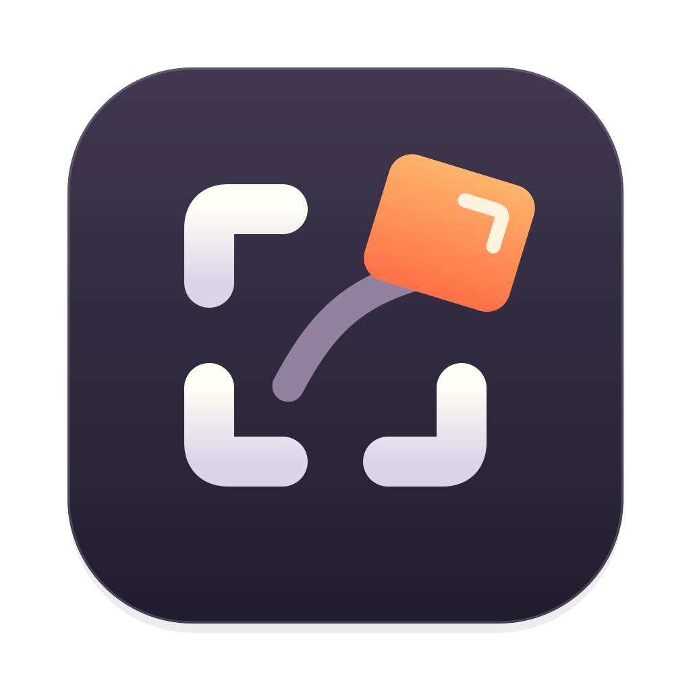

# shothook

Tap a hotkey: screenshot, straight into the AI harness you're using.

No more ⌘⇧4, waiting for the thumbnail, dragging it over and hunting for the composer. Shothook
captures, then **throws** the shot into the harness you used last (Claude, Codex, T3 Code, Cursor,
a terminal running Claude Code or Codex, …) and pastes it into the composer. You just type your prompt.

It's a native macOS menu-bar app, about 1 MB and ~11 MB of memory, with no CPU use while idle. Grabbing the screen takes ~50 ms.

## Use

| Hotkey | Does |
| --- | --- |
| **⇧ ⇧**: tap both Shifts | Instantly captures the display under the pointer |
| **⌘ ⇧ ⇧**: ⌘ + both Shifts | Opens the viewfinder |

Both hotkeys fire when you **release** the keys. A Shift held while typing, or any key or click
during the chord, never triggers them.

**The viewfinder** freezes the screen and dims it, and a pixel loupe follows the pointer.

- **Hover** a window: viewfinder brackets glide onto it. **Click** to grab it.
- **Drag** to grab a region (its size shows as you go).
- **Click the desktop** to grab the whole display.
- **Esc** or right-click cancels.

**The throw:** the captured area flashes like a shutter, lifts off as a little photo and arcs
into the harness's composer with a whoosh. It lands with a ripple and a whomp, and the menu-bar
icon confirms. If you've turned on Reduce Motion, you get a calm fade instead.

### Menu

- **Paste into Harness / Copy to Clipboard Only** switches modes. Clipboard mode works like
  ⌘⌃⇧4, and the shot flies into the menu-bar icon instead.
- **Mute Sounds**
- **Shortcuts**: click an action and press its new hotkey. A modifier combo like ⇧⇧ or a key
  shortcut like ⌥⇧3 both work; ⌫ turns it off. **Reset to Defaults** is there too.
- **Capture Region / Capture Screen**, **Open Config…**, **Reload Config**, **Launch at Login**

## Install

**Homebrew**

```sh
brew install --cask barakt12/tap/shothook
```

**Or download** [**Shothook.dmg**](https://github.com/barakt12/shothook/releases/latest/download/Shothook.dmg),
open it, and drag Shothook into Applications.

> Shothook isn't notarized by Apple yet. The first time you open a downloaded copy, macOS says
> it can't verify it. Go to **System Settings → Privacy & Security** and click **Open Anyway**,
> once. Homebrew installs skip this step.

**Or build it** from source: `scripts/install.sh` (needs Xcode).

Open Shothook. A short setup guide walks you through its two permissions:

- **Screen Recording**: to capture.
- **Accessibility**: for the hotkeys and to send ⌘V to the harness.

**Allow…** opens the exact System Settings pane, with a little helper pinned beneath it. Each
permission ticks off live as you switch it on, and then the guide shows your hotkeys and an
**Open at login** switch. You can reopen it any time from the menu: **Setup Guide…**

If you use a menu-bar manager (Hidden Bar, Bartender,
Ice), Shothook starts next to the clock; ⌘-drag the icon wherever you like.

## Configure

Menu → **Open Config…** edits `~/.config/shothook/config.json`; **Reload Config** applies it.

```json
{
  "mode": "harness",
  "hotkeys": { "screen": "lshift+rshift", "region": "cmd+lshift+rshift" },
  "harnesses": [
    { "bundleId": "com.anthropic.claudefordesktop", "name": "Claude" },
    { "bundleId": "com.mitchellh.ghostty", "name": "Ghostty", "paste": "path" }
  ],
  "effects": true,
  "sound": true,
  "maxLongEdge": 2560
}
```

- **mode**: `harness` (paste into the last-used harness) or `clipboard`.
- **hotkeys**: either form works, and `""` disables one.
  - *Modifier chords* fire on release: `lshift+rshift`, `shift+shift` (both Shifts), `cmd+lshift+rshift`, `rcmd` (right ⌘ alone)…
  - *Key combos*: `opt+shift+4`, `⌃⌥S`, `f13`…
- **harnesses**: the apps that count as harnesses. Find an app's bundle ID with `osascript -e 'id of app "Name"'`.
  - `"paste": "image"` (default): pastes the PNG. For chat GUIs.
  - `"paste": "path"`: pastes the PNG's file path as text. For terminals: Claude Code and Codex CLI turn a pasted image path into an attachment (`[Image #1]`).
  - Running the CLI inside an editor's built-in terminal? Set that editor to `"path"`. Its chat panel then gets the path instead of the image.
- **effects**: the flash, the throw and the ripple. **sound**: the whoosh and whomp, also on the menu as Mute Sounds.
- **maxLongEdge**: shots bigger than this (pixels) are downscaled, since models downsample large images anyway. `0` turns it off.

The defaults already include Claude, Codex, ChatGPT, T3 Code, Cursor, VS Code, Windsurf, Zed,
Ghostty, iTerm, Terminal, Warp, WezTerm, kitty and Alacritty.

## Automation

`open -g shothook://region` opens the viewfinder from Raycast, Shortcuts, BetterTouchTool, or
scripts. There's deliberately no URL for an instant full-screen capture. Any app could fire it
and read the shot off the clipboard without having Screen Recording permission itself, while
the viewfinder captures nothing until you click or drag.

## Good to know

- Pasting needs the harness's **composer focused**, and it usually is. Whenever pasting isn't
  safe (no harness running, its windows closed or minimized, focus moved mid-paste), Shothook
  doesn't guess: the shot stays on your clipboard and the icon says so. Hover it to see why.
- Shothook **replaces your clipboard** with the shot, just like ⌘⌃⇧4 does.
- Shots live in `$TMPDIR/shothook/` and are deleted after 24 hours.

## How it works

- **Hotkeys:** modifier chords come from `flagsChanged` events only, so typing never wakes it. Key combos use Carbon `RegisterEventHotKey`.
- **Routing:** `NSWorkspace` activation notifications track the last-used harness, with no polling.
- **Capture:** in-process ScreenCaptureKit, falling back to `/usr/sbin/screencapture` on older macOS.
- **Viewfinder and throw:** layer-based, GPU-composited panels that don't steal focus.
- **Paste:** a ⌘V sent straight to the harness process, after checking that it's frontmost, has a window and still owns the clipboard.

## Develop

```sh
swift test               # core logic: hotkeys & chords, config, routing, geometry, shot store
scripts/build-app.sh     # build/Shothook.app (universal, signed with your dev identity if found)
python3 scripts/make-sounds.py   # regenerates Support/Sounds/*.wav
scripts/release.sh 0.2.0 --publish   # DMG + zip + cask → GitHub release, bumps ../homebrew-tap
```

With a *Developer ID Application* certificate and a notarytool profile
(`xcrun notarytool store-credentials shothook …`, then `SHOTHOOK_NOTARY_PROFILE=shothook`), the
release script also notarizes and staples, so downloads open without the Gatekeeper prompt.

Signing with a stable identity matters: macOS ties the Screen Recording and Accessibility
grants to the signature, so ad-hoc builds lose them on every rebuild.
